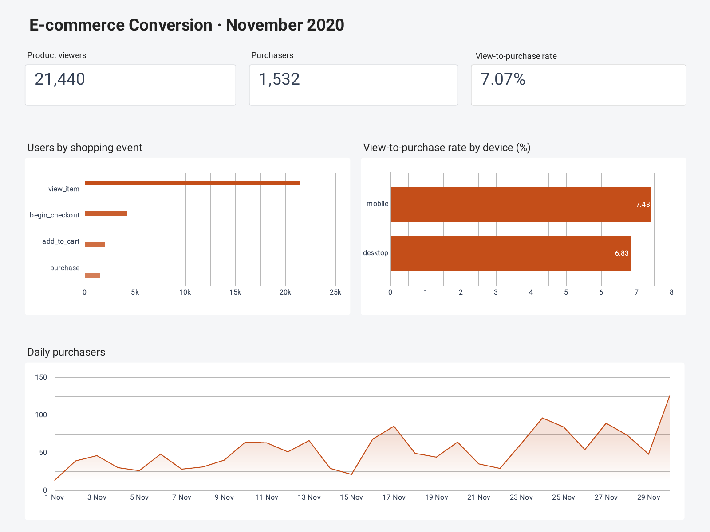

# Analiza konwersji w e-commerce

Sprawdziłam, ilu użytkowników Google Merchandise Store oglądało produkty i ilu z nich później coś kupiło. Porównałam też wyniki dla telefonu i komputera. Dane pochodzą z publicznej próbki GA4 za **1–30 listopada 2020 r.** Pracowałam w BigQuery, Pythonie (Pandas i Matplotlib) oraz Looker Studio. [Dokumentacja danych GA4](https://developers.google.com/analytics/bigquery/web-ecommerce-demo-dataset)

## Jak liczyłam konwersję

Dla każdego zdarzenia policzyłam unikalne `user_pseudo_id`. Wskaźnik **7,07%** to **1 516 / 21 440 × 100**. W liczniku uwzględniłam osoby, u których pierwsze wyświetlenie produktu wystąpiło przed pierwszym zakupem w listopadzie. Liczyłam użytkowników w całym miesiącu. Dane nie pozwalają stwierdzić, czy zakup dotyczył oglądanego produktu albo odbył się w tej samej sesji.

## Wyniki

| Metryka | Wynik |
| --- | ---: |
| Wyświetlenie produktu | 21 440 |
| Dodanie do koszyka | 2 060 |
| Rozpoczęcie zamówienia | 4 219 |
| Kupujący | 1 532 |
| Użytkownicy z wyświetleniem i zakupem | 1 524 |
| Użytkownicy z pierwszym wyświetleniem przed pierwszym zakupem | 1 516 |
| View-to-purchase rate | **7,07%** |

Więcej osób rozpoczęło zamówienie, niż dodało produkt do koszyka. Zdarzenia zliczałam osobno, więc z tych wartości nie da się odtworzyć lejka. W kolejnym kroku sprawdziłabym, czy w sesjach z checkoutem wystąpiło wcześniej dodanie do koszyka.

Wskaźnik wyniósł **7,43% na mobile** i **6,83% na desktopie**. Porównałabym te wyniki w grupach z tego samego źródła ruchu, żeby sprawdzić, czy różnica się utrzymuje. [Wnioski, hipotezy i ograniczenia](insights/business_insights.md)

## Dashboard

Raport pokazuje kluczowe wskaźniki, użytkowników według zdarzenia, dzienną liczbę kupujących i porównanie urządzeń. [Otwórz raport w Looker Studio](https://datastudio.google.com/reporting/cbaa9ff4-41ed-47cd-8f8d-b98d650fef40/page/OB2DG)



## Jak odtworzyć analizę

Zapytania w folderze [`sql/`](sql/) korzystają z publicznego zbioru `bigquery-public-data.ga4_obfuscated_sample_ecommerce`. Notebook czyta gotowe eksporty z folderu [`data/`](data/), sprawdza braki oraz duplikaty i rysuje wykres zdarzeń. [Notebook](python/ecommerce_analysis.ipynb) · [Instrukcja eksportu](data/README.md)

```bash
python -m pip install jupyterlab pandas matplotlib
python -m jupyterlab python/ecommerce_analysis.ipynb
```

W notebooku uruchom wszystkie komórki.
